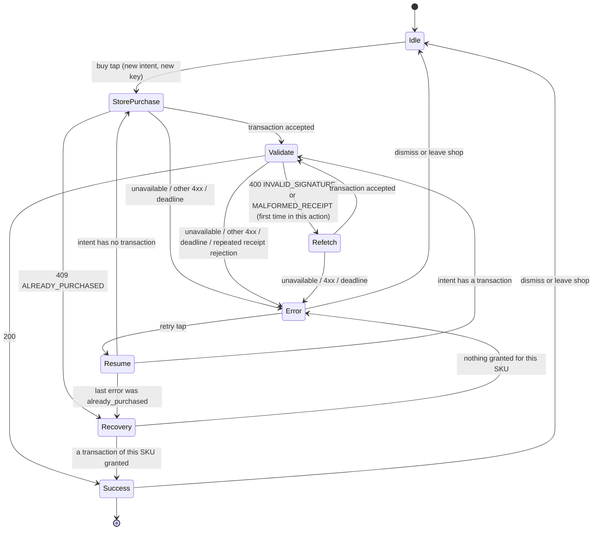

# Purchase flow and failure handling

Status: stage 0 contract. Frozen at tag `stand-v1`.

This document defines how the reference client and server behave at every step of the purchase flow and of the other network calls. It covers what happens when the network or the app fails. Request and response shapes are in [openapi.yaml](openapi.yaml). UI identifiers are in [ui-ids.md](ui-ids.md). Invariants are in [invariants.md](invariants.md).

## 1. Assumptions and guarantee

The reference does not rely on the network or on the app process. For any single call it assumes only this:

- **Delivery.** The server may process a request zero times, once or more than once, at any later moment, including after the client stopped waiting for it.
- **Observation.** The client observes an accepted response, an error response or no usable response. That observation does not have to match what the server did: an error or no response may follow successful processing, and a well-formed response may belong to a different request or player.
- **Process.** The app may leave the foreground, or be stopped at any point and started again later.

**Guarantee.** If at most one exchange of a scenario (one attempt of one call) departs from normal delivery, and the app is stopped at most once, the reference keeps every invariant I1–I10. "After recovery" invariants are checked once the recovery sequence of [invariants.md](invariants.md#recovery) has run.

**Trust boundary.** The server takes a well-formed, authenticated request at its word, except for receipts, which it verifies by signature (I7). In particular, it credits the tap count a batch reports. I10 relies on that count matching the taps made.

## 2. Client network policy

All calls use one policy.

| Constant | Value |
| --- | --- |
| Connect timeout | 2 s |
| Call timeout (whole attempt: connect, send, wait, read) | 6 s |
| Attempts per call | 3 |
| Pause before attempt 2 / attempt 3 | 1 s / 2 s (no jitter) |
| Worst case for one call | 3 × 6 + 1 + 2 = 21 s |
| Action deadline (purchase or spend, measured from the triggering tap) | 45 s |

### Outcome of one attempt

| Outcome | Class |
| --- | --- |
| Connection failure, timeout, connection reset | Retryable |
| HTTP 408, 429, 5xx | Retryable |
| 2xx with a body that fails the schema or the [acceptance rules](#3-response-acceptance-rules) ("invalid response") | Retryable |
| HTTP 401 | See [401 handling](#401-handling) |
| Any other 4xx | Final for this call. The caller handles it by `error.code`. A body without a known code is handled as an unknown 4xx. |
| 2xx that passes acceptance | Success |

When the retryable attempts run out, the call fails with `unavailable`. When the action deadline expires, the in-flight attempt is cancelled and the action fails with `unavailable`. Retries always resend the same body, with the same idempotency key.

### 401 handling

On `401`, whatever `error.code` says, the client re-registers once with its stored `install_id` (`POST /players`, same policy), stores the returned token and repeats the original call once. If re-registration fails, or the repeated call returns `401` again, the call fails with `rejected`. The client never discards `install_id`, its token or any other stored state because of an error response.

## 3. Response acceptance rules

A 2xx response is accepted only if it parses against the schema and passes these checks. Otherwise it is an invalid response (retryable).

| Call | Check |
| --- | --- |
| `POST /players` | `token` is well formed, and its `player_id` part equals `player_id` |
| `GET /player`, embedded `player` snapshots | `player_id` equals the player from the stored token |
| `POST /taps/sync` | `batch_id` and `taps` equal the request |
| `POST /spend` | `spend_id` and `item` equal the request |
| `POST /store/purchases` | `idempotency_key` and `sku` equal the request; the receipt payload decodes; `payload.transaction_id` equals `transaction_id` |
| `GET /store/purchases/{id}`, `.../acknowledge` | `transaction_id` equals the path; the receipt payload decodes |
| `GET /store/purchases` | `player_id` equals the player from the stored token |
| `POST /purchases/validate` | `transaction_id` equals `payload.transaction_id` of the sent receipt |

**Snapshot ordering.** The client keeps in memory the `version` of the snapshot it displays. It applies a snapshot only if its `version` is at least the current one. The version is not persisted: after a cold start, the first accepted snapshot is applied unconditionally.

**Canonical transaction ID.** The client identifies a store transaction by `payload.transaction_id` from its receipt.

## 4. Client persistent state

The client stores this in app-private storage. All of it survives process death and is wiped only by clearing app data.

| Item | Written | Cleared |
| --- | --- | --- |
| Launch config (`backend_url`, `defects`) | On launch with extras (see [launch.md](launch.md)) | App data clear |
| `install_id` | First start, before the first request | App data clear |
| Token | After a successful `POST /players` | Replaced on re-registration |
| Tap queue (count of unsent taps) | On every tap | Decremented after a batch is accepted |
| In-flight tap batch `{batch_id, taps}` | Before the batch is first sent | After the batch is accepted |
| Purchase intent `{sku, idempotency_key, transaction_id?, receipt?}` (at most one) | Before the first store request; transaction and receipt added as soon as a store response is accepted | When a new intent replaces it, after the transaction is acknowledged, or at startup (see [§7](#7-startup-sequence-and-sync-status)) |
| Spend intent `{item, spend_id}` (at most one) | Before the first spend request | On success, when replaced, or at startup |

Balances are not persisted.

## 5. Client purchase state machine

The purchase UI state is `purchase_state`: `idle`, `in_progress`, `success` or `error` (see [ui-ids.md](ui-ids.md)). `success` and `error` are terminal. Internally, `in_progress` goes through these phases:



Rules:

- **Buy tap.** Creates a new purchase intent with a fresh `idempotency_key`, persists it, starts the action deadline and sends `POST /store/purchases`. Only a buy tap creates a key.
- **StorePurchase.** On an accepted response (`200` or `201`), the client persists the transaction ID and receipt into the intent and moves to Validate.
  - `409 ALREADY_PURCHASED` moves to Recovery.
  - `unavailable` fails with error code `unavailable`.
  - Any other 4xx fails with `rejected`. The intent and its key are kept.
- **Validate.** Sends `POST /purchases/validate` with the stored receipt.
  - `200` (either value of `duplicate`) applies the snapshot and goes to Success.
  - The first `400 INVALID_SIGNATURE` or `400 MALFORMED_RECEIPT` in this action goes to Refetch. A repeat fails with `invalid_receipt`.
  - `unavailable` fails with `unavailable`. `403`, other 4xx, and `409 OFFER_ALREADY_OWNED` fail with `rejected`.
- **Refetch.** `GET /store/purchases/{transaction_id}`, then it replaces the stored receipt and returns to Validate.
- **Recovery.** Runs the [pending recovery procedure](#6-pending-recovery-procedure) inside the action deadline.
  - If it grants a transaction of the purchased SKU, the result is Success with that transaction ID (`duplicate` does not matter).
  - Otherwise the result is Error with `already_purchased`, and the intent is discarded.
- **Success.** Shows `purchase_transaction_id`, then starts a background acknowledge (`POST /store/purchases/{id}/acknowledge`, same policy, no deadline). On success the intent is cleared. On failure the transaction stays `pending`, and startup recovery closes it.
- **Retry tap** (`purchase_retry`). Starts a new action deadline and resumes from the intent. It never creates a new idempotency key and never starts a new store purchase for a new key. This is what keeps I10.
- **Dismiss.** Dismissing (`purchase_dismiss`) or leaving the shop returns the UI to `idle`. The persisted intent stays until it is replaced, acknowledged or cleaned up at startup.
- **One action at a time.** Buy buttons are disabled while `purchase_state` is `in_progress`, or while the startup sequence has not finished.
- **Acknowledge order.** The client never acknowledges a transaction it has not validated successfully.

Purchase error codes shown in `purchase_error_code`:

| Code | Cause |
| --- | --- |
| `unavailable` | Retries exhausted (network, timeout, 5xx, invalid responses) or action deadline expired |
| `invalid_receipt` | The receipt was rejected again after a refetch |
| `already_purchased` | The store refused a one-time product, and recovery granted nothing for it |
| `rejected` | Any other final 4xx, or 401 that re-registration could not fix |

The error message must not claim the player was or was not charged. It says that a paid purchase will be delivered automatically.

## 6. Pending recovery procedure

Used at startup, in the Recovery phase, and by the automatic sync retry.

1. `GET /store/purchases?status=pending`.
2. For each transaction, oldest first:
   1. `POST /purchases/validate` with its receipt. On the first `INVALID_SIGNATURE` or `MALFORMED_RECEIPT`, refetch it by ID and validate once more.
   2. On `200`, apply the snapshot and acknowledge the transaction.
   3. On failure, record the failure and continue with the next transaction.
3. The procedure succeeds if every listed transaction ended validated and acknowledged.

The store's pending list is the source of truth. A local intent is never needed to recover a paid transaction.

## 7. Startup sequence and sync status

`sync_status` is `syncing`, `idle` or `error`. On every process start:

1. Read the launch config. If any defect ID is unknown, show `screen_config_error` and make no requests (see [launch.md](launch.md)).
2. Generate and persist `install_id` if there is none.
3. If there is no token, `POST /players`.
4. `GET /player`.
5. Resend the persisted in-flight tap batch (same `batch_id`), then flush the tap queue.
6. Run the pending recovery procedure.
7. Clean up the persisted purchase intent:
   - An intent without a transaction ID is discarded. If its store request did reach the store, the transaction was handled in step 6.
   - An intent whose transaction is no longer pending is discarded.
   - A spend intent is discarded without resending. The spend was either applied or not; both are valid.
8. Buy and spend buttons become enabled.

`sync_status` is `idle` only when all of these hold:

- A snapshot has been applied since process start.
- The tap queue is empty and no batch is in flight.
- The last pending recovery succeeded.
- No acknowledge request is outstanding.

While any of these is running, it is `syncing`. If a step fails after its retries, it is `error`. In that state the client retries the failed steps automatically every 10 s, and immediately when `sync_retry` is tapped. During those attempts the status is `syncing`.

## 8. Tap sync

- Taps are added to the persisted queue at once, and the displayed coins include an estimate (see [game.md](game.md#display-rules)).
- A flush runs when 50 or more taps are queued, every 2 s while the queue is non-empty, before a spend, when the app goes to the background, and at startup.
- At most one batch is in flight. A flush takes `n = min(queue, 200)`, persists `{batch_id, n}` and sends it. On success, it removes `n` from the queue, clears the in-flight batch and applies the snapshot.
- A failed batch stays persisted and is resent with the same `batch_id`. A batch is never split, merged or re-keyed.
- `409 IDEMPOTENCY_CONFLICT` cannot happen while the client follows these rules. If it does, the batch is dropped and `sync_status` becomes `error`.

## 9. Spend

- `upgrade_button` and `booster_button` start a spend action with a 45 s deadline:
  1. Flush taps.
  2. Persist a spend intent with a new `spend_id`.
  3. Send `POST /spend`.
- The UI state is `spend_state`: `idle`, `in_progress`, `success` or `error`. Its error codes are `unavailable`, `insufficient_funds`, `max_level` and `rejected`.
- `spend_retry` resends the same `spend_id`. A new tap on a spend button creates a new `spend_id`.

## 10. Server state

### Store transaction

```
(none) --POST /store/purchases--> pending --acknowledge--> acknowledged
```

There are no other states and no transitions back. A transaction is never deleted except by a reset.

### Backend grant per transaction

```
not granted --validate (valid receipt)--> granted
```

At most one `purchase_grant` journal entry exists per `transaction_id`. A unique constraint enforces this.

### Combined state

| Store | Backend | Reachable in reference | What finishes it |
| --- | --- | --- | --- |
| pending | not granted | Yes | Validate, then acknowledge (purchase flow or recovery) |
| pending | granted | Yes | Acknowledge (background or recovery) |
| acknowledged | granted | Yes (final) | — |
| acknowledged | not granted | No, the client only acknowledges after validating | Validate grants it. I2 takes priority over I7. |

### Server requirements

- Every mutating request runs in one SQLite transaction (`BEGIN IMMEDIATE`). Balance changes and journal entries are committed together.
- Idempotency keys are protected by unique constraints, so concurrent duplicates cannot both apply.
- Balances are stored as columns on the player row, separately from the journal. They are never computed from the journal at read time.
- `starter_offer` is unique per player in the store (partial unique index on `(player_id, sku)` for one-time SKUs).
- No mutating request has a partial effect. On error, nothing is committed.

## 11. Failure matrix: purchase flow

The matrix is organized by what the client observes, because that is all the client can act on. "No usable response" means a connection error, a timeout, `408`, `429`, `5xx`, or a `2xx` that fails the [acceptance rules](#3-response-acceptance-rules). "Retry" means the next attempt under the policy of §2. "Recovery" means the next pending recovery (in this action or at startup). Every row keeps I1–I10, whatever the server actually did.

| Step | Client observes | Possible server state | Correct client behavior |
| --- | --- | --- | --- |
| `POST /store/purchases` | No usable response | No transaction, or exactly one for this key | Retry with the same key. When retries run out: Error `unavailable`; the retry tap reuses the key |
| | `409` | A one-time transaction may exist under another key | Recovery. If it grants this SKU: Success; otherwise Error `already_purchased` |
| | Other final 4xx | No transaction, or one for this key | Error `rejected`, key kept. The retry tap reuses the key; otherwise startup recovery grants any created transaction |
| | Accepted response | One transaction for this key | Persist it, go to Validate |
| `POST /purchases/validate` | No usable response | Not granted, or granted once | Retry. A later `200` may carry `duplicate: true`; both mean Success |
| | `400` with a receipt error code | Not granted, or granted once | Refetch, then validate once more |
| | Other final 4xx | Not granted, or granted once | Error `rejected` (allowed by I9). Recovery grants or confirms the grant, then acknowledges |
| | Accepted response | Granted once | Success |
| `GET /store/purchases/{id}` (refetch) | Anything but an accepted response | Unchanged | Retry. When retries run out: Error `unavailable`; recovery finishes it |
| `POST .../acknowledge` | Anything but an accepted response | Pending or acknowledged | Retry in the background. When retries run out, the transaction stays pending and startup recovery acknowledges it (validate returns `duplicate: true` first) |
| `GET /store/purchases?status=pending` | Anything but an accepted response | Unchanged | Retry. When retries run out: `sync_status` `error`, automatic retry |

A receipt that reaches the client altered fails validation with `400`. The refetch returns the store's original receipt, and validation then grants.

## 12. Failure behavior of other calls

| Call | No usable response | Final 4xx |
| --- | --- | --- |
| `POST /players` | Retry. Idempotent by `install_id` | Startup step fails, `sync_status` `error` |
| `GET /player` | Retry. A snapshot with an older `version` is ignored | `sync_status` `error` |
| `GET /catalog` | Retry | `catalog_state` `error` |
| `POST /taps/sync` | Retry with the same `batch_id` | See §8 |
| `POST /spend` | Retry with the same `spend_id` | Error with the mapped code |

An outdated catalog can show an expired or already bought offer as available. Buying it then either succeeds, because a paid purchase is always granted, or ends in `already_purchased` after recovery. Neither is a violation.

## 13. App killed during the purchase flow

On the next start, the startup sequence (§7) finishes the purchase without user input. The purchase UI comes back as `idle`.

| Killed | Store state | Outcome after restart |
| --- | --- | --- |
| Before the store request was sent | None | Intent discarded, no transaction |
| After sending, before the response | Maybe pending | Recovery grants and acknowledges it, if it exists |
| After the response, before the intent was updated | Pending | Recovery grants and acknowledges it |
| Before or during validate | Pending, maybe granted | Recovery validates (maybe `duplicate: true`) and acknowledges |
| After Success, before or during acknowledge | Pending, granted | Recovery validates (`duplicate: true`) and acknowledges |
| During a tap batch | — | The in-flight batch is resent with the same `batch_id` |
| During a spend | — | The spend intent is discarded. The spend was applied once or not at all |

## 14. Constants summary

| Constant | Value | Defined in |
| --- | --- | --- |
| Connect timeout / call timeout | 2 s / 6 s | §2 |
| Attempts, pauses | 3; 1 s, 2 s | §2 |
| Action deadline (purchase, spend) | 45 s | §2 |
| Automatic sync retry | every 10 s | §7 |
| Tap flush | 50 taps or every 2 s; batch at most 200 | §8 |
| N (terminal state bound) | 60 s | [invariants.md](invariants.md#constants) |
| Recovery pauses and sync wait | P1 = 5 s, R = 60 s, P2 = 2 s | [invariants.md](invariants.md#recovery) |
| Offer window | 600 s | [game.md](game.md#starter-offer) |
